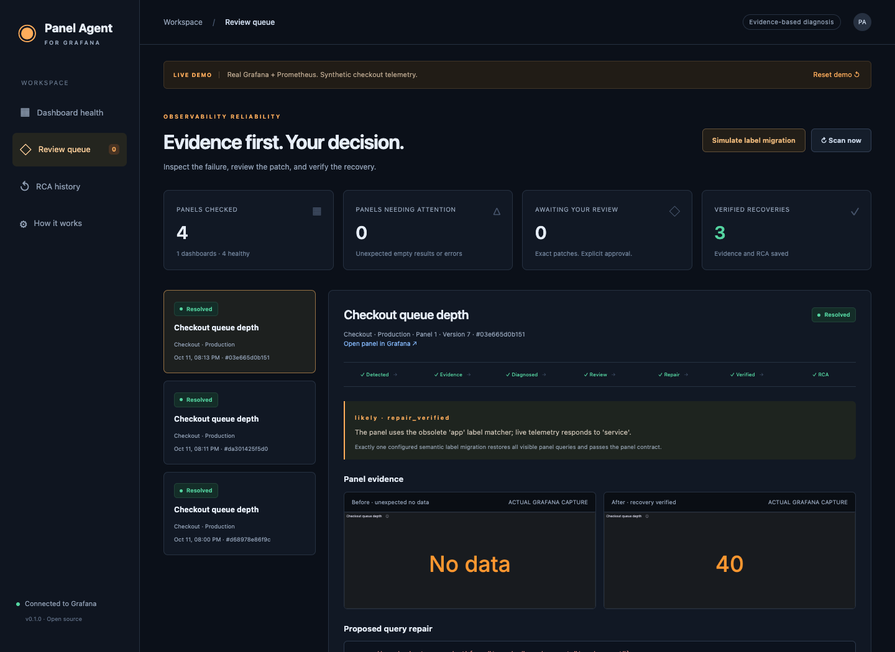
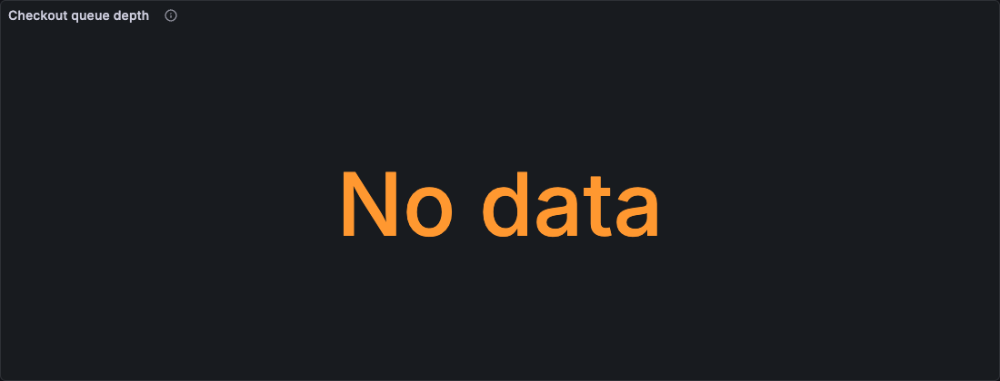
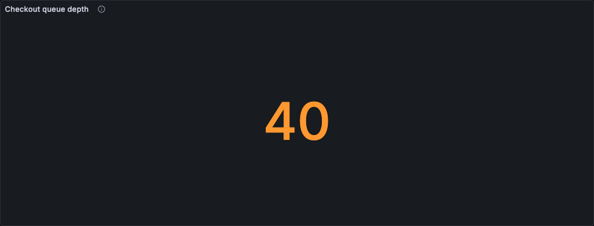
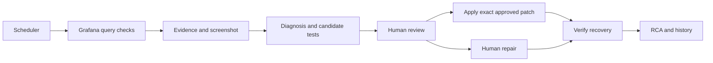

# Grafana Panel Agent

Continuously check Grafana panels, capture real failure screenshots, investigate the evidence, review an exact query repair, verify recovery, and retain an RCA.

The included demo runs **real Grafana and Prometheus** with synthetic checkout telemetry. A simulated exporter deployment renames a metric label, the queue-depth panel shows **No data**, and the agent proposes a tested repair. A reviewer can approve it, reject it, or fix the dashboard manually.



## Run the demo

Requirements: Python 3.9+, Node 20+, and macOS or Linux. Docker is an alternative.

```sh
npm ci
npx playwright install chromium
python3 scripts/demo.py
```

The native launcher downloads pinned official Grafana 12.3.6 and Prometheus 3.15.0 binaries, verifies their SHA-256 checksums, and keeps binaries/state in the ignored `.runtime/` directory. It starts four services on loopback: Grafana `3000`, Prometheus `9090`, the synthetic exporter `9109`, and the agent `8787`.

Open **http://127.0.0.1:8787**. The underlying dashboard is at **http://127.0.0.1:3000/d/guardian-checkout**. Grafana's synthetic-demo login is `admin` / `local-demo-only`; anonymous access is Viewer only. Ctrl+C stops the native stack.

For Docker:

```sh
docker compose up --build
```

The same two browser URLs work. Docker publishes its UI ports only to loopback. State lives in named volumes. The Compose file and demo credentials are for the isolated synthetic environment.

If using an installed Chrome instead of a downloaded Chromium:

```sh
export CHROME_EXECUTABLE="/path/to/chrome"
python3 scripts/demo.py
```

## Walk through the working flow

1. **Healthy baseline.** The inventory checks four panel contexts. Three return telemetry; the error panel is deliberately empty and has an explicit `allow_empty` contract.
2. **Simulate label migration.** Click that button in the workspace. The exporter changes `app="checkout"` to `service="checkout"` on the queue-depth metric. Prometheus marks the old series stale at the next scrape.
3. **Investigate.** The next check detects the unexpected empty result. The agent captures the actual Grafana panel, retrieves metric metadata, checks scrape health, reads the recorded deployment, and tests the configured semantic label migration against live data.
4. **Review.** Open the investigation. Compare the screenshot, original query, evidence and candidate query. The service value, production environment filter and metric identity remain intact.
5. **Approve and apply.** Approval records the reviewer, proposal hash and dashboard revision. The agent rechecks the candidate, saves one query change through Grafana, and verifies three fresh evaluations of the saved revision.
6. **Keep the RCA.** The investigation retains before/after images, decisions, query results, the timeline and prevention recommendations. Download the report or open RCA history.

You can also choose **Reject proposal** without changing Grafana. Or edit the dashboard yourself and choose **Verify human fix**. Periodic scans independently notice recovery as well.

The automated demonstration acts as the explicitly named **demo-reviewer**, not as a real production human approver.

| Before | After |
| --- | --- |
|  |  |

[Recorded RCA](docs/demo/sample-rca.md) · [Recorded verification](docs/demo/verification.json) · [Step-by-step screenshots](docs/DEMO.md)

## Connect an existing Grafana instance

```sh
cp config.example.json config.json
export GUARDIAN_GRAFANA_TOKEN='your-grafana-service-account-token'
export GUARDIAN_REVIEW_TOKEN='a-random-secret-of-at-least-24-characters'
python3 -m guardian serve --config config.json
```

Edit the URL, dashboard tags, contexts and panel contracts before starting. Environment variables hold credentials; `.env` is an example format and is **not automatically loaded**. Authenticate in the workspace with the review token. The default bind address is `127.0.0.1`.

- `tags`: Grafana search tags to inventory. An empty list scans all accessible standard dashboards.
- `contexts`: explicit variable combinations keyed by dashboard UID. Single-value saved defaults can also resolve variables. Coverage is per configured context, not every possible variable combination.
- `contracts`: keys use `dashboard-uid:panel-id`. Use `expect_data`, `allow_empty`, `min_series`, `expected_labels`, `max_age_seconds`, and optionally `freshness_selector` / `scrape_selector`.
- `freshness_selector`: a raw Prometheus selector whose source sample age is checked with `time() - timestamp(...)`. Without it, age applies to query-result timestamps; evaluation timestamps alone cannot establish source freshness.
- `label_migrations`: explicit semantic aliases, such as `{"app":"service"}`. Only a unique migration that restores every visible query and passes the contract becomes executable. Do not configure unrelated labels as interchangeable.
- `consecutive_failures`: debounce unexpected failures before creating an incident.
- `screenshot_mode`: `playwright`, Grafana's configured `renderer`, or `disabled`.
- `grafana_public_url`: optional browser-facing URL when the API/screenshot worker uses an internal Grafana address.
- `changes_url`: optional trusted HTTP endpoint returning a JSON array of deployment/change records. Correlation is treated as context, not independent causal proof.

Queries returning zero are healthy data. Null-only results are empty. Panels that have neither an explicit data expectation nor an observed healthy baseline are marked unverified when empty.

Start with read/query Grafana permissions. Applying a repair additionally requires dashboard write permission on its folder/resource. This release uses one configured Grafana identity, and supports approval-bound dashboard query patches only. It does not restart infrastructure, modify collector configuration, or change application instrumentation.

The reviewer token is a shared prototype credential with a configured reviewer name. For team deployments, place the service behind your authenticated TLS reverse proxy and add individual identity/authorization before relying on reviewer identity for compliance.

## Optional AI advisor

The reproducible demo runs **without an LLM**, using evidence-based diagnosis and configured semantic migrations. It does not label rule output as model output.

To add a read-only model advisor:

```sh
export OPENAI_API_KEY='your-api-key'
export GUARDIAN_MODEL='your-available-model-id'
python3 -m guardian serve --config config.json
```

The integration uses the OpenAI Responses API with a strict JSON schema, `store: false`, bounded evidence and validated evidence references. The model receives **no write tools**. Its narrative and suggested query remain advisory; they cannot authorize a patch or expand the executable repair policy. Configure `model_include_screenshot: true` to include the PNG as model input with a vision-capable model.

Configuring this advisor sends the evidence bundle, and optionally the screenshot, to the configured API. The default endpoint is `https://api.openai.com/v1/responses`; `GUARDIAN_MODEL_API_URL` can select a compatible endpoint. Avoid including sensitive telemetry in exported demonstration artifacts.

Live model calls need your own API credentials. The supplied verification run tested the request schema and response validation with a stub, and exercised the actual Grafana repair flow using rules. See [official structured-output documentation](https://developers.openai.com/api/docs/guides/structured-outputs?api-mode=responses).

## Architecture and controls



- Python's standard library provides the API server, scheduler, HTTP client and SQLite persistence. Node/Playwright provides isolated browser capture. No user browser profile is accessed.
- Scans and mutations are serialized; repeated failures use a stable panel/context fingerprint.
- Approval binds to the proposal SHA-256, complete dashboard snapshot and panel contract. Grafana's dashboard version provides the final optimistic-concurrency check. An intervening edit blocks the repair.
- A failed recovery check rolls back only when the dashboard has not changed since the agent's save. Otherwise the incident requires manual review.
- Evidence/API routes require authentication. Session cookies are HttpOnly and SameSite=Strict; cross-origin mutations are rejected. There is no arbitrary-command or unrestricted model execution endpoint.
- SQLite and evidence files are durable in the state directory/volume. A process restart retains prior incidents. Back up that directory for durable history.

See [API reference](docs/API.md), [contributing](CONTRIBUTING.md), and [security reporting](SECURITY.md).

## Supported scope

Version 0.1 is tested with **Grafana 12.3.6**, using its standard dashboard JSON and legacy HTTP APIs, plus Prometheus 3.15.0. Standard Prometheus stat/time-series queries, nested row panels, explicit data-source UIDs and resolved variables are supported.

Library panels, client-side transformations, repeated panels, panel time overrides, ambiguous variables, expression queries and other data sources are explicitly **unverified**. They are not silently counted as healthy. This is a functional prototype, not a replacement for independent monitoring of Grafana, Prometheus or the agent itself. Successful recovery verifies the repair; the RCA distinguishes that from proving every contributing cause.

## Test and reproduce

```sh
python3 -m unittest discover -s tests -v
# With the demo already running:
npm run test:e2e
```

The suite covers approval hashes, changed revisions/contracts, rejection, manual fixes, rollback, permissions, intentional emptiness, zero/null values, missing dimensions, unsupported coverage, authentication and model-output validation. The browser test uses real services and writes screenshots, an RCA and its verification record to `docs/demo/`.

GitHub Actions includes unit and Docker-based integration jobs. Local evidence was generated with the native macOS stack; the Docker job provides an additional reproducible Linux check.

## License

Original project code is MIT licensed. Grafana, Prometheus and Playwright retain their respective licenses; their binaries are downloaded or used as container dependencies and are not committed to this repository.
