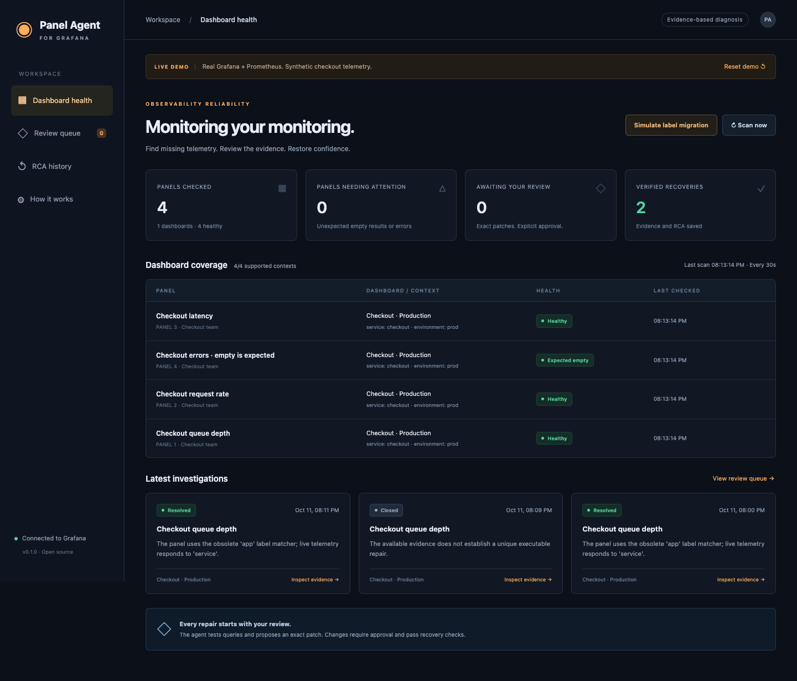
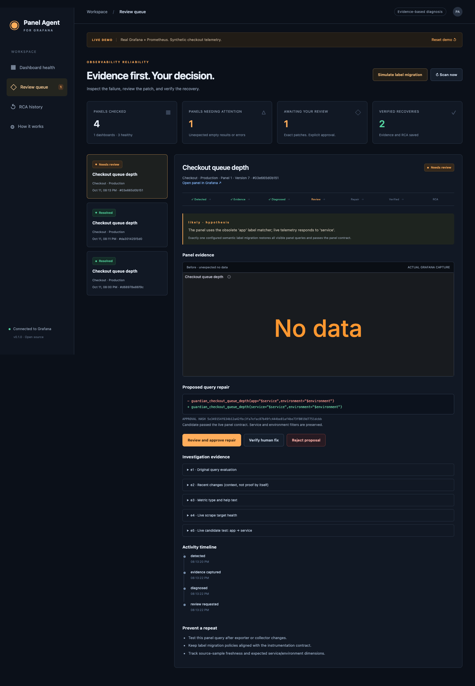
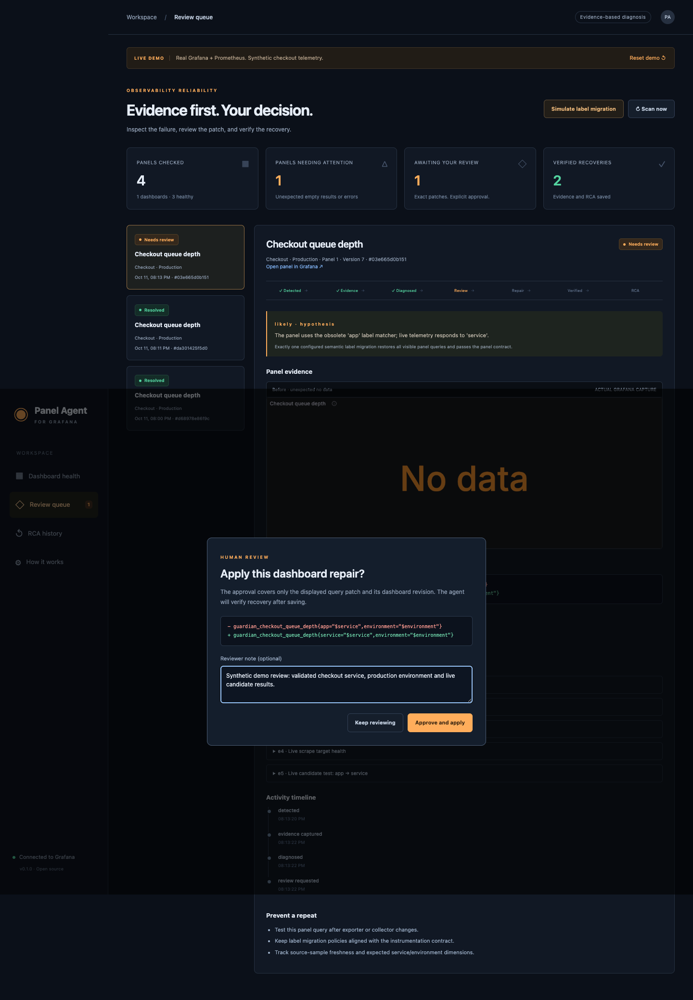
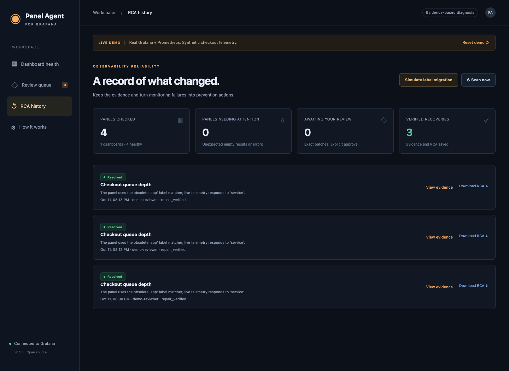

# Recorded end-to-end demonstration

This recording uses real Grafana 12.3.6 and Prometheus 3.15.0 with synthetic checkout traffic. No production account or production metric was modified.

## 1. Healthy dashboard coverage

Three panels return data. The deliberately empty error panel has an `allow_empty` contract and does not create an incident.

## 2. Real exporter label migration

The exporter stops emitting `app="checkout"` and emits `service="checkout"` instead. Grafana's original instantaneous queue-depth query returns no data. The agent captures the panel and tests a replacement matcher without changing Grafana.

## 3. Explicit review of the precise patch

The simulated reviewer checks the service and environment scope, adds a note, and approves the displayed query diff. Approval includes the proposal hash and dashboard revision.

## 4. Repair and verification

Grafana saves the approved query change. Three fresh evaluations pass; the agent captures the recovered panel and stores the RCA. The simulated reviewer identity is `demo-reviewer`.

[Full investigation screenshot](demo/04-recovered.png) · [Raw incident evidence](demo/incident.json)

## 5. Persisted incident history

[Download the RCA](demo/sample-rca.md) · [Verification record](demo/verification.json)

The demo diagnosis uses deterministic evidence rules. The optional AI advisor is implemented and its structured request/response handling is tested with a stub; no live model API key was available for this recording.
